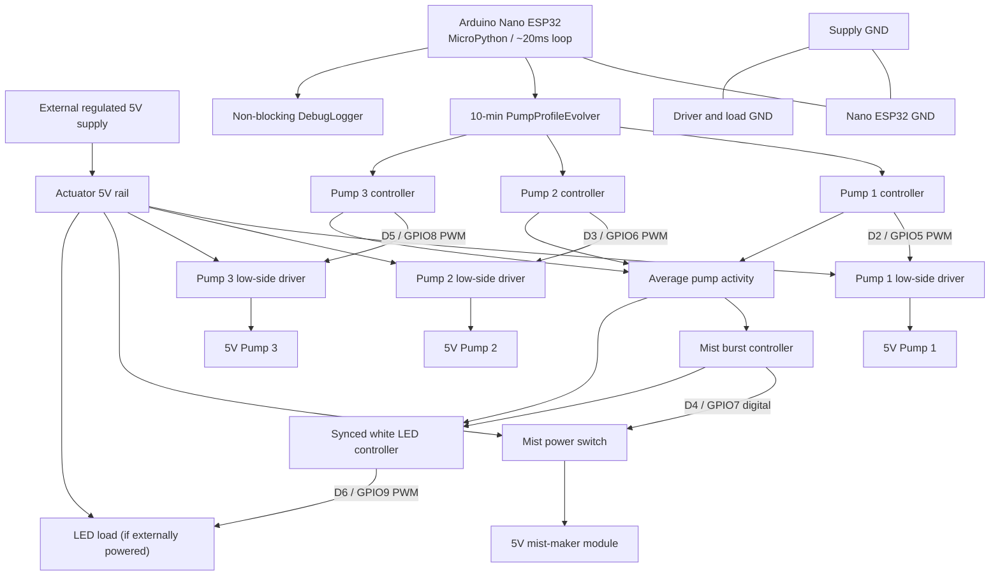

## Board and pinout

Target board: **Arduino Nano ESP32 (ESP32-S3)** running MicroPython. The pins below are a proposed allocation for this build; the D labels are the board silkscreen names and the GPIO numbers are the ESP32 pin IDs to use with `machine.Pin`/`machine.PWM` in MicroPython.

| Function | Nano ESP32 header | MicroPython GPIO | Signal / connection |
|---|---|---:|---|
| Pump 1 speed | D2 | GPIO5 | PWM to 3.3V-compatible MOSFET driver input |
| Pump 2 speed | D3 | GPIO6 | PWM to 3.3V-compatible MOSFET driver input |
| Mist enable | D4 | GPIO7 | Digital output to mist power-switch input |
| Pump 3 speed | D5 | GPIO8 | PWM to 3.3V-compatible MOSFET driver input |
| White LED brightness | D6 | GPIO9 | PWM to LED driver; direct only for a low-current LED with resistor |
| Serial logging | USB-C | — | Use native USB serial; leave D0/D1 available for UART/boot diagnostics |

The Nano ESP32 pin mapping is documented in the [Arduino Nano ESP32 User Manual](https://docs.arduino.cc/tutorials/nano-esp32/cheat-sheet/). Confirm MicroPython's board firmware and pin numbering before wiring; use the **GPIO number**, not the D label, in `machine.Pin(n)`. The board uses **3.3V GPIO**: never apply 5V to a pin. Four PWM outputs are needed for this allocation; check the selected MicroPython build's PWM support and resource limits.

## Power and wiring

- Use a regulated external **5V actuator supply** sized for the combined worst-case/stall current of all pumps and the mist module. The 3A figure is a starting recommendation, not a substitute for checking each load's current rating. Fuse the actuator branch appropriately for its wiring and components.
- Power the Nano ESP32 separately over USB during bring-up, or use its documented input method. Do not feed the actuator rail from a GPIO, the 3.3V pin, or USB VBUS; do not connect an external 5V rail to VBUS. Join the external supply negative, Nano ESP32 GND, driver grounds, and load returns at a common ground.
- For each pump's low-side N-channel MOSFET stage: supply `+5V` to pump `+`; pump `-` to the driver's switched output / MOSFET drain; MOSFET source and driver ground to common GND; GPIO PWM to the driver input. Module terminal names vary, so follow that module's wiring diagram. Select a driver explicitly specified to switch fully from **3.3V logic** and rated above the pump's startup/stall current.
- Add a bulk electrolytic capacitor (e.g. **220–470µF**, voltage rating above 5V) across the actuator `+5V` and GND near the loads, observing polarity; add local ceramic bypassing if the load/module documentation recommends it. Keep motor-current wiring short and separate from signal wiring where practical.
- Brushless pumps often contain their own electronic driver. Verify that the exact pump permits supply-side PWM, and follow its specified PWM frequency and startup behavior. PWM duty is **not** a steady reduced voltage; a duty floor such as `150/255` does not guarantee a 3V pump voltage or reliable startup. If unsupported, use the pump's dedicated control input or on/off control instead. Fit a flyback diode only if appropriate for the pump/driver manufacturer's instructions, and size it for the load current; do not assume a small 1N5819 suits every pump.
- Switch only a **complete, self-contained 5V mist-maker module** with its compatible power switch. GPIO7 controls the switch input; the module gets power from the external 5V rail. Do not connect a bare ultrasonic transducer to a GPIO or ordinary MOSFET. Use the firmware's slow burst enable (e.g. 1500ms period), not motor-frequency PWM, and confirm the module tolerates the chosen power-cycle cadence and water level.
- For a small bare white LED, wire GPIO9 → series resistor → LED anode; LED cathode → common GND. Calculate the resistor from the LED's forward voltage and desired current, and keep pin current conservative (a **220Ω resistor** is a reasonable starting point for many indicator LEDs, subject to the LED datasheet). Use a separate 3.3V-logic-compatible MOSFET driver for a brighter LED/strip; provide its required current limiting and do not exceed its ratings.
- Keep the controller, supply, and exposed connections above and protected from splashes; use drip loops and an isolated, approved low-voltage supply. Keep mains wiring away from the water feature.

## Bring-up checklist

1. With loads disconnected, verify the 5V rail polarity and common ground; confirm no GPIO can be exposed to 5V.
2. Test each driver input with a meter/LED or a current-limited test load before attaching pumps or the mist module.
3. Connect and test one actuator at a time; measure startup current and confirm the supply, wiring, MOSFET, and any protection component remain within their ratings.
4. Verify the pump PWM frequency/start floor and mist module's safe burst timing from their actual datasheets before unattended operation.